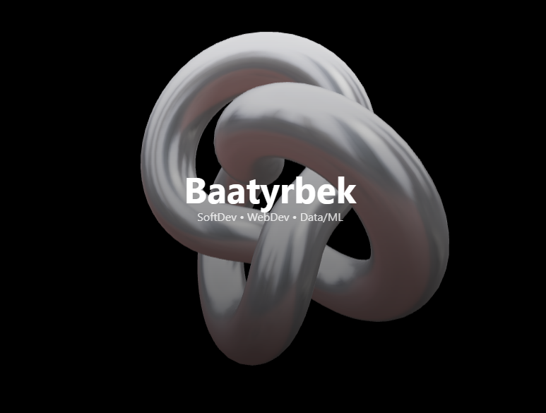

# MyWebsite — MERN Portfolio with Three.js, self-hosted



An interactive personal portfolio showcasing projects, skills, and contact via a **React (Vite) + Tailwind + Three.js** frontend and an **Express API** with **MongoDB**.
It runs on a self-hosted Kubernetes cluster at https://bturatov.me: container images are built by GitHub Actions, published to GHCR and rolled out by ArgoCD from a separate GitOps repository.

## ✨ Features

- 3D interactions via **@react-three/fiber** + **drei** (GLTF models, decals, lights); **responsive layout**
- **Projects** & **Skills** served from **Express + MongoDB (Mongoose)**
- **Contact** endpoint with **rate limiting** and **SMTP** (Nodemailer); every message is stored in MongoDB before the email is sent; **MailHog** in dev
- **Dockerized dev** with **Dockerfiles** + **Docker Compose** (client, server, MongoDB, MailHog)
- **GitHub Actions CI/CD**: push to `main` → build web and api images → push to GHCR → bump the image tags in the GitOps repo → ArgoCD deploys
- Test on real phones over LAN with Vite `--host`

## Tech Stack

- **Frontend:** React, Vite, Tailwind CSS, Framer Motion, Three.js (@react-three/fiber, @react-three/drei)
- **Backend:** Node 22, Express (ESM), Mongoose, Nodemailer
- **Database:** MongoDB 7 (self-hosted StatefulSet)
- **Serving:** nginx (SPA + `/api` reverse proxy), Envoy Gateway (Gateway API) with Let's Encrypt certificates from cert-manager
- **Infra & DevOps:** Kubernetes, ArgoCD, **Docker**, **GitHub Actions** + GHCR, Prometheus alerts for the public site

## How it is deployed

```
visitor ─ DNS ─ home router (port forward 80/443) ─ Envoy Gateway "public" ─ nginx (web) ─┬─ static SPA
                                                                                          └─ /api ─ Express (api) ─ MongoDB
```

- `client/Dockerfile` builds the SPA and serves it with nginx (`client/nginx.conf`); `server/Dockerfile` runs the API. Both run as non-root with a read-only filesystem.
- `.github/workflows/build-and-deploy.yml` builds both images on every push to `main`, tags them with the commit SHA and updates the tags in the GitOps repo (secret `GITOPS_DEPLOY_KEY`).
- The cluster manifests live in the GitOps repository (`apps/portfolio`), not here. Secrets (database, SMTP, admin key) are created in the cluster and never committed.
- The API reads `TRUST_PROXY` (number of proxies in front of it) so rate limiting sees the real visitor IP.

## Project Structure
```bash
myweb/
│── client/                        # React + Vite frontend
│   ├── Dockerfile                 # production image: build + nginx
│   ├── Dockerfile.dev             # dev container
│   ├── nginx.conf                 # SPA fallback, caching, /api proxy
│   ├── public/                    # static assets (icons, GLTF models, favicon)
│   └── src/                       # components, pages, hooks (useProjects, useSkills), main.jsx
│
│── server/                        # Express API
│   ├── Dockerfile                 # production image
│   ├── Dockerfile.dev             # dev container
│   ├── db/                        # JSON exports of projects and skills (mongoimport)
│   └── src/
│       ├── env.js                 # env mapping
│       ├── db.js                  # Mongo connection (Mongoose)
│       ├── models/                # Project, Skill, Message
│       ├── routes/                # projects, skills, contact
│       ├── utils/mailer.js        # Nodemailer SMTP
│       └── index.js               # express app
│
│── .github/workflows/
│   └── build-and-deploy.yml       # build images, push to GHCR, bump tags in the GitOps repo
│
│── docker-compose.dev.yml         # client, server, MongoDB, MailHog for local development
│── README.md
```

## Key Notes

- For mobile performance in Three.js, reduce shadows/polycount and use dpr={[1,2]}.
- Many GLTF models ship with transforms; center and scale once using Box3 utilities.
- To load the project and skill data into an empty database:
  `mongoimport --db <db> --collection skills --jsonArray --file server/db/R\&R.skills.json` and the same for `projects.json`.

## Installation & Usage

Prerequisites
- Node.js 22+ and npm
- Docker Desktop (for the Docker workflow)
- Git

Project Structure
```bash
myweb/
├─ client/
│  ├─ src/
│  ├─ vite.config.(ts|js)
│  ├─ .env.development      # client env for local dev (NOT secrets)
│  └─ .env.production       # optional; build-time vars for prod preview
├─ server/
│  ├─ src/
│  ├─ Dockerfile.dev
│  └─ .env                  # server-only secrets
└─ docker-compose.dev.yml
```
### Option A — Run locally (no Docker)
1. Install dependencies
```bash
cd server && npm ci
cd ../client && npm ci
```

2. Create server/.env 
```bash
# HTTP
PORT=5050
CLIENT_ORIGIN=http://localhost:5173

# Database (choose one)
# Local/host Mongo
# MONGO_URI=mongodb://localhost:27017/myweb
# Atlas/remote Mongo
MONGO_URI=mongodb+srv://<user>:<pass>@cluster0.xxxxx.mongodb.net/myweb

# Mail (optional; for MailHog use)
SMTP_HOST=localhost
SMTP_PORT=1025
SMTP_SECURE=false
# SMTP_FROM="My Web <me@example.com>"
```

3. Start dev server
```bash
# Terminal 1
cd server && npm run dev

# Terminal 2
cd client && npm run dev
```

### Option B — Run with Docker (recommended for contributors)
This path lets new contributors clone → up with hot reload.
The API reads environment variables from server/.env using env_file.

1. Put your real values in server/.env
```bash
PORT=5050
CLIENT_ORIGIN=http://localhost:5173
# Use Atlas or your host DB:
...
```
2. Start the stack
```bash
docker compose -f docker-compose.dev.yml up -d --build #from root
```

3. Services <br>
Web (Vite): http://localhost:5173 <br>
API: http://localhost:5050